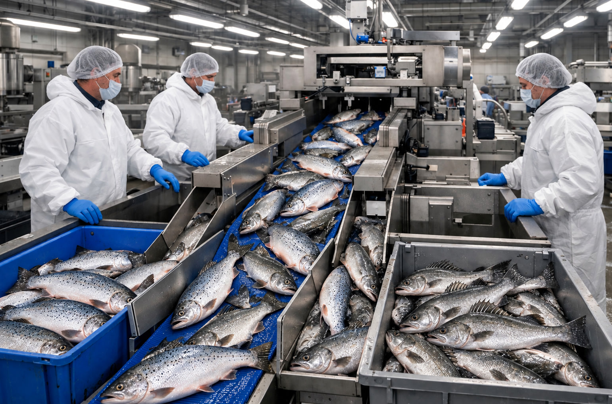
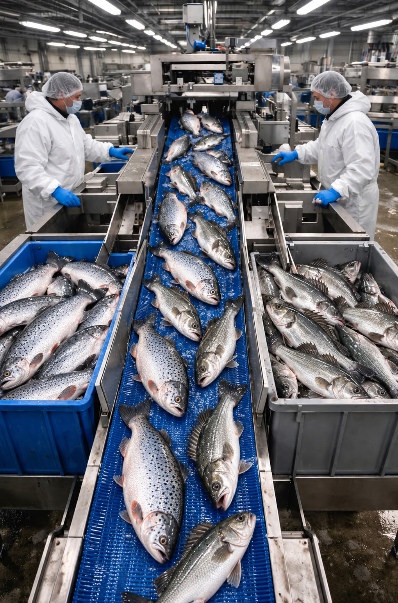

## 分類問題

### 今回の目標
- 分類問題（[data classification]{.en}）：データを分類するタスクを理解する
    - 2クラス分類
- データの可視化（[visualization]{.en}）
- **決定境界（[decision boundary]{.en}）** の概念を学ぶ

::: {.callout-note title="重要ポイント"}
- 完全な分類は困難であることを知る
- 境界決定のトレードオフ（[trade-off]{.en}）とコスト
:::


## 今回の問題


### サケとスズキが混ざったなかからサケだけを選別せよ

::: {.columns}
::: {.column width="60%" .column-center}

- ２種類の魚がベルトコンベアで大量に流れてくるとする
  - **サケ**（Salmon）
  - **スズキ**（Sea bass）
- これを自動で瞬時に識別したい
- **クラス（[class]{.en}）**：分類先の項目
   - この場合は２クラス 

:::
::: {.column width="40%"}
{fig-align="center" width="80%"}
:::
:::


::: {.takeaway .center}
Salmon と Sea bass の**2クラス分類問題（[2-class classification]{.en}）**
:::


## 選別システム

::: {.columns .columns-tight}
::: {.column width="60%" .column-center}
```{.d2 sketch="true" width="100%"}
direction: down
A: ベルトコンベアに魚を流す { style.fill: "#e1f5ff" }
B: 途中で重さを測定 { style.fill: "#fff4e1" }
D: 何かしらの判定器 { shape: diamond; style.fill: "#ffd9d9" }
E: 鮭として加工 { style.fill: "#ffcccb" }
F: スズキとして加工 { style.fill: "#add8e6" }
A -> B -> D
D -> E: Salmon
D -> F: Sea bass
```
:::
::: {.column width="40%"}
{fig-align="center"}
:::
:::


## 重さだけで分類してみる

### アプローチ

- 重量計をつけられそうなので、まず重さで識別できないかを考えた
- サンプルとして20匹ずつの重さを測定した


```{python}
#| echo: true
# Salmon（20匹）の重さ (g)
salmon_weights = [2149, 1959, 2194, 2457, 1930, 1930, 2474, 2230, 1859, 2163,
                  1861, 1860, 2073, 1426, 1483, 1831, 1696, 2094, 1728, 1576]


# Sea bass（20匹）の重さ (g)
seabass_weights = [1677, 1327, 1486, 1440, 1857, 1476, 1749, 2203, 1979, 1468,
                   1496, 1737, 1099, 1341, 1748, 1563, 2181, 1414, 1286, 1333]

```


```{python}
#| echo: false
import altair as alt
import pandas as pd
alt.renderers.enable("png")

df = pd.DataFrame({
    "Weight": salmon_weights + seabass_weights,
    "Species": ["Salmon"] * 20 + ["Sea bass"] * 20
})

alt.Chart(df).mark_tick(size=18, thickness=2).encode(
    x=alt.X("Weight:Q", title="Weight (g)", scale=alt.Scale(zero=False)),
    y=alt.Y("Species:N", title=None, axis=alt.Axis(labelAngle=0)),
    color=alt.Color("Species:N", legend=None)
).properties(height=150, width=480)
```


## 準備

pandas, numpy, matplotlib, scikit-learn をインストールする。

```bash
pip install pandas numpy matplotlib scikit-learn
```

続けて、以下を実行

```{python}
#| echo: true

import numpy as np

# numpy配列にキャスト
salmon_weights = np.array(salmon_weights)
seabass_weights = np.array(seabass_weights)
```

```{python}
#| echo: false

# Author-side setup: figures and tables in this deck are shown, not written by students
import matplotlib.pyplot as plt
import japanize_matplotlib
import pandas as pd

plt.rcParams["font.size"] = 11
plt.rcParams["figure.dpi"] = 100
```


## まずはヒストグラム

```{python}
#| echo: true
#| code-fold: true
#| code-summary: "（参考）描画コード"
#| fig-align: center
import matplotlib.pyplot as plt
import japanize_matplotlib

plt.figure(figsize=(10, 6))
bins = range(1000, 2600, 100)

plt.hist(salmon_weights, bins=bins, histtype="step", 
         edgecolor="black", linewidth=2, label="Salmon")
plt.hist(seabass_weights, bins=bins, histtype="step", 
         edgecolor="red", linewidth=2, label="Sea bass")

plt.xlabel("Weight (g)", fontsize=14)
plt.ylabel("Count", fontsize=14)
plt.title("Distribution of Fish Weight", fontsize=16, fontweight="bold")
plt.legend(fontsize=13)
plt.grid(True, alpha=0.3)
plt.tight_layout()
plt.show()
```

## 統計値を見る

```{python}
#| echo: true
#| fig-align: center
#| code-fold: false
#| code-summary: "code"
print(f"Salmon   - 最小: {min(salmon_weights)}g, 最大: {max(salmon_weights)}g, 平均: {np.mean(salmon_weights):.0f}g")
print(f"Sea bass - 最小: {min(seabass_weights)}g, 最大: {max(seabass_weights)}g, 平均: {np.mean(seabass_weights):.0f}g")
overlap_min = max(min(salmon_weights), min(seabass_weights))
overlap_max = min(max(salmon_weights), max(seabass_weights))
if overlap_max >= overlap_min:
    print(f"\n重なり範囲: {overlap_min}g - {overlap_max}g")
```

::: {.callout-warning title="ここまでで分かること"}
- **双峰型の分布（[bimodal distribution]{.en}）**：2つの山が見える
  - **かなり重なっている**が、まあ分けてみましょう
:::

## 境界線（閾値）を考える {#peek-decision-boundary}

大体でいいので **しきい値（[threshold]{.en}）** を設定する。


### 方針

**1800g以上** → Salmon

**1800g未満** → Sea bass

この判定ルールで分類してみる。


::: {.takeaway}
**決定境界**（[decision boundary]{.en}）：閾値で分かれる境界
:::

## 青の破線で切ったとしたら

```{python}
#| echo: false
#| fig-align: center
threshold = 1800

plt.figure(figsize=(10, 6))
bins = range(1000, 2600, 100)

plt.hist(salmon_weights, bins=bins, histtype="step", 
         edgecolor="black", linewidth=2, label="Salmon")
plt.hist(seabass_weights, bins=bins, histtype="step", 
         edgecolor="red", linewidth=2, label="Sea bass")

# Add threshold line
plt.axvline(x=threshold, color="blue", linestyle="--", linewidth=2.5, 
           label=f"Threshold = {threshold}g")

plt.xlabel("Weight (g)", fontsize=14)
plt.ylabel("Count", fontsize=14)
plt.title("Distribution with Decision Boundary", fontsize=16, fontweight="bold")
plt.legend(fontsize=13)
plt.grid(True, alpha=0.3)
plt.tight_layout()
plt.show()
```

## 分類結果：4つのパターン

### 境界線1800gで分類すると、4つのパターンが生まれる

| 実際の魚 | 判定結果 | 略称 | 説明 |
|----|----|------|--------|
| Salmon | Salmon | **TP** (True Positive) | **正しくSalmon**と判定 |
| Sea bass | Sea bass | **TN** (True Negative) | **正しくSalmonではない**と判定 |
| Sea bass | Salmon | **FP** (False Positive) | **誤ってSalmon**と判定 |
| Salmon | Sea bass | **FN** (False Negative) | **Salmonを見逃し** |


## TP/FP/TN/FNの覚え方


### 右から左に読む

1. **右（P/N）** 判定結果 → Positive（サケ）or Negative（それ以外）
2. **左（T/F）** その答え合わせ → True（正解）or False（不正解）

```{.d2 sketch="true" width="78%"}
direction: right
J: "判定器の出力" { style.fill: "#e1f5ff" }
P: "Positive\n（Salmon である）" { style.fill: "#fff4e1" }
N: "Negative\n（Salmon ではない）" { style.fill: "#fff4e1" }
TP: "TP" { style.fill: "#d5f5e3" }
FP: "FP" { style.fill: "#f5b7b1" }
TN: "TN" { style.fill: "#d5f5e3" }
FN: "FN" { style.fill: "#f5b7b1" }
J -> P
J -> N
P -> TP: 当たり
P -> FP: はずれ
N -> TN: 当たり
N -> FN: はずれ
```


## 境界線1800gで4つのパターンを数える {#peek-cm-1800}

- `seabass_weights >= threshold` は、40匹それぞれの判定を True / False で並べた配列
- [`np.sum`](numpy-recipes.qmd#peek-np-count){.peek} は True を 1、False を 0 として足すので、条件を満たした**匹数**になる

```{python}
#| echo: true
threshold = 1800

print(seabass_weights[:5] >= threshold)   # 先頭5匹の判定

TP = np.sum(salmon_weights >= threshold)   # Salmon を正しく Salmon と判定
FN = np.sum(salmon_weights < threshold)    # Salmon を見逃し
TN = np.sum(seabass_weights < threshold)   # Sea bass を正しく Sea bass と判定
FP = np.sum(seabass_weights >= threshold)  # Sea bass を誤って Salmon と判定
print(f"TP={TP}, FN={FN}, FP={FP}, TN={TN}")
```


## 混同行列（[Confusion Matrix]{.en}） {#peek-confusion-matrix}

```{python}
#| echo: true
#| code-fold: true
#| code-summary: "（参考）描画コード"
#| fig-align: center
import matplotlib.pyplot as plt
import japanize_matplotlib
import matplotlib.patches as mpatches

fig, ax = plt.subplots(figsize=(9, 7))

# Confusion matrix data
cm_data = np.array([[TP, FP], [FN, TN]])

# Color map: 緑=正解、ピンク=誤り
colors = np.array([["#90EE90", "#FFB6C6"], ["#FFB6C6", "#90EE90"]])

# Draw cells
for i in range(2):
    for j in range(2):
        ax.add_patch(mpatches.Rectangle((j, 1-i), 1, 1, 
                                        facecolor=colors[i, j], 
                                        edgecolor="black", linewidth=2.5))
        ax.text(j + 0.5, 1.5 - i, str(cm_data[i, j]), 
               ha="center", va="center", fontsize=48, fontweight="bold")
        
        # Add label
        if i == 0 and j == 0:
            label = "TP"
        elif i == 0 and j == 1:
            label = "FP"
        elif i == 1 and j == 0:
            label = "FN"
        else:
            label = "TN"
        ax.text(j + 0.5, 1.15 - i, label, 
               ha="center", va="center", fontsize=16, style="italic", color="gray")

# Set labels
ax.set_xlim(0, 2)
ax.set_ylim(0, 2)
ax.set_xticks([0.5, 1.5])
ax.set_yticks([0.5, 1.5])
ax.set_xticklabels(["Actual: Salmon", "Actual: Sea bass"], fontsize=13, fontweight="bold")
ax.set_yticklabels(["Predict: Sea bass", "Predict: Salmon"], fontsize=13, fontweight="bold")
ax.set_aspect("equal")
ax.tick_params(length=0)
ax.set_title(f"Confusion Matrix (Threshold = {threshold}g)", 
            fontsize=16, fontweight="bold", pad=20)

plt.tight_layout()
plt.show()
```


## 混同行列から評価指標（[Evaluation Metrics]{.en}）を計算する

::: {.table-style widths="auto" first-col-rule="3px" col-rules="all" head-rule="3px" head-align="center" rule-color="#aaa"}
| 指標 | 日本語 | 意味 | 計算式 |
|-----|-------|-----------|:-------:|
| **Accuracy** | 正解率 （or 精度）| 正しく判定できたデータの割合<br> SalmonとSalmonではないものの判定 | $\dfrac{TP + TN}{TP + FP + FN + TN}$ |
| **Precision** | 適合率（or 精度） | **Salmonと判定**したら、<br>**本当にSalmonだった**割合 | $\dfrac{TP}{TP + FP}$ |
| **Recall** | 再現率（or 感度） | **本当はSalmonだったデータ**のうち、<br>**見逃さず**Salmonと判定できた割合 | $\dfrac{TP}{TP + FN}$ |
:::

::: {.callout-warning title="「精度」は曖昧な用語"}
Accuracy（正解率）を指す場合と、Precision（適合率）を指す場合がある。
:::

::: {.callout-note title="Accuracyだけではダメな理由"}
- クラス間の偏り（[class imbalance]{.en}）に影響される
   - 例：100匹のうちSalmonが5匹なら、すべてを「Salmonではない」と判定するだけでAccuracyは95%になる
:::

## 境界線1800gの判定器を評価する

- [境界線1800gの混同行列](#peek-cm-1800){.peek}の値を計算式に代入する

```{python}
#| echo: true
# Calculate metrics
accuracy = (TP + TN) / (TP + TN + FP + FN)
precision = TP / (TP + FP) if (TP + FP) > 0 else 0
recall = TP / (TP + FN) if (TP + FN) > 0 else 0

print(f"Accuracy  = ({TP} + {TN}) / {TP + TN + FP + FN} = {accuracy:.3f}")
print(f"Precision = {TP} / ({TP} + {FP}) = {precision:.3f}")
print(f"Recall    = {TP} / ({TP} + {FN}) = {recall:.3f}")
```

## しきい値を変えると？

```python
thresholds = [1600, 1800, 2000]
```


```{python}
#| echo: false
#| fig-align: center
#| output: true
thresholds = [1600, 1800, 2000]
results = []

for threshold in thresholds:
    TP = np.sum(salmon_weights >= threshold)
    FN = np.sum(salmon_weights < threshold)
    TN = np.sum(seabass_weights < threshold)
    FP = np.sum(seabass_weights >= threshold)

    accuracy = (TP + TN) / (TP + TN + FP + FN)
    precision = TP / (TP + FP) if (TP + FP) > 0 else 0
    recall = TP / (TP + FN) if (TP + FN) > 0 else 0
    
    results.append({
        "threshold": f"{threshold}g",
        "TP": TP,
        "FP": FP,
        "FN": FN,
        "TN": TN,
        'Precision': f"{precision:.1%}",
        'Recall': f"{recall:.1%}",
        'Accuracy': f"{accuracy:.1%}"
    })

df = pd.DataFrame(results)
print(df.to_string(index=False))
```

:::{.callout-important}
- **決定境界の閾値を下げる（1600g）** → Recall ↑、Precision ↓  
  - Salmonの見逃しは減る（FN減）が、Sea bassの誤判定が増える（FP増）
  
- **決定境界の閾値を上げる（2000g）** → Precision ↑、Recall ↓  
  - Salmon判定の信頼性は上がるが、Salmonの見逃しが増える（FN増）
:::


::: {.takeaway}
**Precision と Recall はトレードオフの関係**
:::


## しきい値の比較（1600g vs 2000g）

:::: {.columns}

::: {.column width="50%"}
```{python}
#| echo: false
threshold = 1600

plt.figure(figsize=(5.5, 4.5))
bins = range(1000, 2600, 100)

plt.hist(salmon_weights, bins=bins, histtype="step", 
         edgecolor="black", linewidth=2, label="Salmon")
plt.hist(seabass_weights, bins=bins, histtype="step", 
         edgecolor="red", linewidth=2, label="Sea bass")
plt.axvline(x=threshold, color="blue", linestyle="--", linewidth=2.5, 
           label=f"Threshold={threshold}g")

plt.xlabel("Weight (g)", fontsize=11, fontweight="bold")
plt.ylabel("Count", fontsize=11, fontweight="bold")
plt.title(f"Low Threshold ({threshold}g)", fontsize=13, fontweight='bold')
plt.legend(fontsize=10)
plt.grid(True, alpha=0.3, linestyle="--")
plt.tight_layout()
plt.show()

# Calculate metrics
TP = np.sum(salmon_weights >= threshold)
FN = np.sum(salmon_weights < threshold)
TN = np.sum(seabass_weights < threshold)
FP = np.sum(seabass_weights >= threshold)
precision = TP / (TP + FP) if (TP + FP) > 0 else 0
recall = TP / (TP + FN) if (TP + FN) > 0 else 0
```

::: {.callout-note title="結果"}
- FP が増え、FN が減る
- **Precision** は低く、**Recall** は高い
:::

:::

::: {.column width="50%"}
```{python}
#| echo: false
threshold = 2000

plt.figure(figsize=(5.5, 4.5))
bins = range(1000, 2600, 100)

plt.hist(salmon_weights, bins=bins, histtype="step", 
         edgecolor="black", linewidth=2, label="Salmon")
plt.hist(seabass_weights, bins=bins, histtype="step", 
         edgecolor="red", linewidth=2, label="Sea bass")
plt.axvline(x=threshold, color="blue", linestyle="--", linewidth=2.5, 
           label=f"Threshold={threshold}g")

plt.xlabel("Weight (g)", fontsize=11, fontweight="bold")
plt.ylabel("Count", fontsize=11, fontweight="bold")
plt.title(f"High Threshold ({threshold}g)", fontsize=13, fontweight='bold')
plt.legend(fontsize=10)
plt.grid(True, alpha=0.3, linestyle="--")
plt.tight_layout()
plt.show()

# Calculate metrics
TP = np.sum(salmon_weights >= threshold)
FN = np.sum(salmon_weights < threshold)
TN = np.sum(seabass_weights < threshold)
FP = np.sum(seabass_weights >= threshold)
precision = TP / (TP + FP) if (TP + FP) > 0 else 0
recall = TP / (TP + FN) if (TP + FN) > 0 else 0
```

::: {.callout-note title="結果"}
- FP が減り、FN が増える
- **Precision** は高く、**Recall** は低い
:::

:::

::::

## どの指標を重視すべきか？ {#peek-which-metric}

### ケース1: 高級レストラン向け出荷
- **Precision重視**（FPを避ける）
- 高めの閾値（2000g）
- Sea bassの混入を最小化
   - 混入絶対許さないマン


### ケース2: 缶詰工場（Salmon専用ライン）
- **Recall重視**（FNを避ける）
- 低めの閾値（1600g）
- Salmonの取りこぼしを最小化
   - シャケなら余すことなく全部入れるマン（混入は知らね）

## コストを考慮した最適化 {#peek-cost}


::: {.takeaway}
誤分類のコストが異なる場合は、総コストが最小になる閾値を選ぶ
:::
$$
\begin{aligned}
&\text{argmin}(\text{総コスト}) = N(\text{FP}) \times \text{Cost}(\text{FP}) + N(\text{FN}) \times \text{Cost}(\text{FN})\\
&\quad \small{N(x): x\text{の個数},\; \text{Cost}(x): x\text{ 1個あたりのコスト}}
\end{aligned}
$$
```{python}
#| echo: true
#| fig-align: center
#| code-fold: true
#| code-summary: "code"
#| output: true
# 例：Sea bass混入のクレーム対応コストが高い場合
C_FP = 10000  # Sea bass混入のクレーム対応コスト（円/匹）
C_FN = 500    # Salmon再選別コスト（円/匹）

thresholds = [1600, 1800, 2000]
costs = []
for threshold in thresholds:
    FN = np.sum(salmon_weights < threshold)    # Salmon を見逃し
    FP = np.sum(seabass_weights >= threshold)  # Sea bass を誤って Salmon と判定
    total_cost = FP * C_FP + FN * C_FN
    costs.append(total_cost)
    print(f"{threshold}g: FP={FP:>2}, FN={FN:>2}, cost=¥{total_cost:,}")

best_threshold = thresholds[costs.index(min(costs))]
print(f"min cost: {best_threshold}g")
```

::: {.callout-note title="結果"}
Sea bass 混入（FP）のコストが高いので、高めのしきい値で総コストが最小になる
:::

## **Tweak** しきい値を変更 {.badge-practice}

- [4つのパターンを数えるコード](#peek-cm-1800){.peek}の `threshold` と、[コスト最適化のコード](#peek-cost){.peek}を**書き換えて実行**（指標のセルまで続けて実行）

::: {.tweak}
| やりたいこと | コード |
|--|--|
| 全部 Salmon と判定せよ | `threshold = 1000` |
| 全部 Sea bass と判定せよ | `threshold = 2500` |
| 再選別のコストのほうを高くせよ | `C_FP = 500`、`C_FN = 10000` |
:::

::: {.callout-tip title="チェックポイント"}
- `threshold = 1000` で **Recall は 100%** になる
   - 全部 Salmon と判定するだけで得られる値
   - そのとき Precision は 50%、Accuracy も 50%
      - ==単独の指標は当てにならない==
- コストを入れ替えると、最適しきい値が **高い側から低い側に反転**する
:::


## ROC曲線：分類器の性能を可視化 {#peek-roc}

- Precision と Recall はトレードオフ
   - 1つの閾値での値だけでは、分類器の性能を表せない
- **ROC（[Receiver Operating Characteristic]{.en}）曲線**：閾値を全通り試した結果を描いた図


::: {.takeaway}
ROC曲線の描き方：全閾値で以下を計算して折れ線グラフにする
:::
- 縦軸（**Recall**）：[TP Rate]{.en}$= \dfrac{TP}{TP + FN}$
- 横軸（Precisionの代わり）：[FP Rate]{.en}$= \dfrac{FP}{FP + TN}$

## ROC曲線の見方

::: {.callout-tip title="重要ポイント"}
- 分布が離れているほど、曲線は左上の角（FP Rate 0、TP Rate 1）に近づく
- 分布が重なっているほど、曲線は対角線（ランダムに判定した場合）に近づく
- もし曲線が対角線より下にあるなら、判定したラベルが逆
   - 値の小さいほうを Salmon と判定すれば対角線の上に移る
:::


```{python}
#| echo: false
#| fig-align: center
# Two hypothetical features drawn from exact normal densities (no random numbers):
# Salmon ~ N(mu, 1), Sea bass ~ N(0, 1); mu = 2.5 separates well, mu = 0.5 hardly at all.
from scipy.stats import norm

x = np.linspace(-4, 6.5, 400)
fig, axes = plt.subplots(2, 2, figsize=(9.5, 7.2), gridspec_kw={"height_ratios": [1, 2]})
for col, (mu, title) in enumerate([(2.5, "よく分かれる特徴量"), (0.5, "ほとんど分かれない特徴量")]):
    ax = axes[0, col]
    ax.plot(x, norm.pdf(x, mu, 1), color="black", lw=2, label="Salmon")
    ax.plot(x, norm.pdf(x, 0, 1), color="red", lw=2, label="Sea bass")
    ax.set_title(title, fontsize=12)
    ax.set_yticks([])
    ax.legend(fontsize=9, loc="upper right")

    ax = axes[1, col]
    t = np.linspace(-6, 9, 600)          # thresholds from "all Salmon" to "all Sea bass"
    ax.plot(norm.sf(t, 0, 1), norm.sf(t, mu, 1), color="#e74c3c", lw=2.5)
    ax.plot([0, 1], [0, 1], color="gray", linestyle="--", lw=1.2, label="ランダムに判定")
    ax.set_xlim(-0.02, 1.02)
    ax.set_ylim(-0.02, 1.02)
    ax.set_aspect("equal")
    ax.set_xlabel("FP Rate")
    ax.set_ylabel("TP Rate（Recall）")
    ax.legend(loc="lower right", fontsize=9)
    ax.grid(True, alpha=0.3)
plt.tight_layout()
plt.show()
```


## コード（ROC曲線） {#peek-roc-code}

- 閾値をずらしながら TP Rate と FP Rate を計算し、グラフにする
   - 最小値は全部を Salmon、最大値 + 1 は全部を Sea bass と判定する閾値
      - この範囲の外では結果が変わらないので、調べる必要はない

```{python}
#| echo: true
#| fig-align: center
weights = np.concatenate([salmon_weights, seabass_weights])     # 40 匹の重さ
tpr = []   # TP Rate（Recall）
fpr = []   # FP Rate
for threshold in range(np.min(weights), np.max(weights) + 2):   # 最小値から、最大値 + 1 まで 1g ずつ
    TP = np.sum(salmon_weights >= threshold)
    FN = np.sum(salmon_weights < threshold)
    FP = np.sum(seabass_weights >= threshold)
    TN = np.sum(seabass_weights < threshold)
    tpr.append(TP / (TP + FN))
    fpr.append(FP / (FP + TN))

plt.figure(figsize=(5, 5))
plt.plot(fpr, tpr, color="#e74c3c", label="重さで判定")
plt.plot([0, 1], [0, 1], color="gray", linestyle="--", label="ランダムに判定")
plt.xlabel("FP Rate")
plt.ylabel("TP Rate（Recall）")
plt.legend()
plt.grid(True, alpha=0.3)
plt.show()
```


## AUC：ROC曲線の下の面積で分離性能を表す指標 {#peek-auc}

- **AUC**（[Area Under the Curve]{.en}）：ROC 曲線の下の面積
   - 1.0：完全に分離可能（曲線が左上の角を通る）
   - 0.5：全く分離不可能（対角線と同じ）
- 面積は、隣り合う 2 点の間を台形とみなして、その面積を足して求める
   - [ROC曲線のコード](#peek-roc-code){.peek}で作った `tpr` と `fpr` をそのまま使う

```{python}
#| echo: true
auc = 0
for i in range(len(fpr) - 1):
    width  = fpr[i] - fpr[i + 1]          # 台形の幅（閾値を上げると FP Rate は下がる）
    height = (tpr[i] + tpr[i + 1]) / 2    # 上底と下底の平均
    auc += width * height
print(f"重さの AUC: {auc:.3f}")
```

```{python}
#| echo: false
#| output: false
# Check of the value in doc/measured-log.md: the trapezoid sum above, NumPy's trapezoid
# rule and the share of (Salmon, Sea bass) pairs with the heavier Salmon all give 0.805.
pairs = sum(1.0 if s > b else 0.5 if s == b else 0.0 for s in salmon_weights for b in seabass_weights)
assert abs(auc - (-np.trapezoid(tpr, fpr))) < 1e-12 and abs(auc - pairs / 400) < 1e-12 and round(auc, 3) == 0.805
```

::: {.callout-note title="結果"}
- 重なってはいるが、ランダムに判定するよりずっと良い
:::


## 重さだけで分類した結論

::: {.callout-important title="重要ポイント"}
1. **重さだけでは完全な分類は不可能**
   - データの分布が重なっている（重さの [AUC](#peek-auc){.peek} は完全分離の 1.0 に届かない）
   
2. **境界線は「方針の選択」**
   - 正解/不正解ではなく、用途に応じた最適化（[optimization]{.en}）
   
3. **評価指標はトレードオフ**
   - 例：Precision ↑ だと Recall ↓
   - どちらを重視するかは用途次第
:::


## 練習問題

下記の新データ（それぞれ20匹ずつ追加した）について、以下の1〜4を実行して分類器をつくれ

```{python}
#| echo: true
salmon_weights = [2149, 1959, 2194, 2457, 1930, 1930, 2474, 2230, 1859, 2163,
                  1861, 1860, 2073, 1426, 1483, 1831, 1696, 2094, 1728, 1576,
                  2028, 1903, 2057, 2229, 1884, 1884, 2240, 2081, 1838, 2037,
                  1839, 1838, 1978, 1554, 1591, 1820, 1731, 1992, 1752, 1652]
seabass_weights = [1677, 1327, 1486, 1440, 1857, 1476, 1749, 2203, 1979, 1468,
                   1496, 1737, 1099, 1341, 1748, 1563, 2181, 1414, 1286, 1333,
                   1787, 1445, 1505, 1204, 1381, 1513, 1259, 1567, 1370, 1432,
                   1370, 1864, 1488, 1278, 1657, 1245, 1533, 1096, 1223, 1531]

```


0. まず何をするべきかを考えよ

1. 閾値を1800gにした場合の TP, FP, FN, TN を計算せよ

2. 1800gの場合の **Accuracy, Precision, Recall** を求めよ

3. 1700gの場合の **Accuracy, Precision, Recall** を求めよ

4. $C_{FP}=5000$円、$C_{FN}=1000$円としたとき、総コストを最小にするしきい値を求めよ

## 問0の答え（可視化）

```{python}
#| echo: false
#| fig-align: center
threshold = 1800

plt.figure(figsize=(10, 6))
bins = range(1000, 2600, 100)

plt.hist(salmon_weights, bins=bins, histtype="step", 
         edgecolor="black", linewidth=2, label="Salmon")
plt.hist(seabass_weights, bins=bins, histtype="step", 
         edgecolor="red", linewidth=2, label="Sea bass")


plt.xlabel("Weight (g)", fontsize=14)
plt.ylabel("Count", fontsize=14)
plt.title("Distribution with Decision Boundary", fontsize=16, fontweight="bold")
plt.legend(fontsize=13)
plt.grid(True, alpha=0.3)
plt.tight_layout()
plt.show()
```
