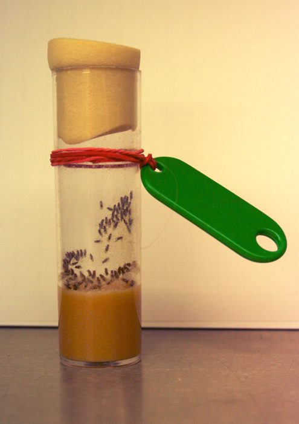

## ここまで

- [**勾配降下法**](optimization-gradient-descent.qmd#peek-gd-code){.peek}（[gradient descent]{.en}）：少しずつ進んで最小値を探す
- **回帰**：体長→重さの直線を勾配降下法でフィッティング
   - [このケースでは解と一致](linear-regression.qmd#peek-exact-line){.peek}
- **分類（[classification]{.en}）**：特徴量からクラスを予測
   - [決定木](classification-2d-boundaries.qmd#peek-tree-boundary){.peek}：軸に平行な閾値を組み合わせて分ける
   - [k-NN](knn-curse.qmd#peek-knn-code){.peek}：近い $k$ 個のデータの投票で決める


::: {.callout-note title="今回の主題"}
- [「斜めの直線で分けられそう」と言いながら、斜めの直線は求めていなかった](classification-2d-boundaries.qmd#peek-diagonal){.peek}
- データから最適な**斜めの決定境界（[decision boundary]{.en}）**を求められるか？
:::


## 分類問題で出てきた閾値の縦線

```{python}
#| echo: false
#| fig-align: center
#| classes: fig-medium
import numpy as np
import matplotlib.pyplot as plt
import japanize_matplotlib
plt.rcParams["font.size"] = 11
plt.rcParams["figure.dpi"] = 100

salmon_weights     = np.array([2149, 1959, 2194, 2457, 1930, 1930, 2474, 2230, 1859, 2163,
                               1861, 1860, 2073, 1426, 1483, 1831, 1696, 2094, 1728, 1576,
                               2028, 1903, 2057, 2229, 1884, 1884, 2240, 2081, 1838, 2037,
                               1839, 1838, 1978, 1554, 1591, 1820, 1731, 1992, 1752, 1652])
salmon_brightness  = np.array([3.5, 5.8, 4.9, 4.4, 2.6, 2.6, 2.2, 5.5, 4.4, 4.8, 2.1,
                               5.9, 5.3, 2.8, 2.7, 2.7, 3.2, 4.1, 3.7, 3.2, 4.4, 2.6,
                               3.2, 3.5, 3.8, 5.1, 2.8, 4.1, 4.4, 2.2, 4.4, 2.7, 2.3,
                               5.8, 5.9, 5.2, 3.2, 2.4, 4.7, 3.8])
seabass_weights    = np.array([1677, 1327, 1486, 1440, 1857, 1476, 1749, 2203, 1979, 1468,
                               1496, 1737, 1099, 1341, 1748, 1563, 2181, 1414, 1286, 1333,
                               1787, 1445, 1505, 1204, 1381, 1513, 1259, 1567, 1370, 1432,
                               1370, 1864, 1488, 1278, 1657, 1245, 1533, 1096, 1223, 1531])
seabass_brightness = np.array([5.6, 7.5, 5.2, 9.5, 6.3, 8.3, 6.6, 7.6, 7.7, 5.9, 9.8,
                               8.9, 9.7, 9.5, 8.0, 9.6, 5.4, 6.0, 5.2, 6.6, 6.9, 6.4,
                               9.1, 6.8, 6.4, 7.7, 5.7, 9.0, 5.4, 9.9, 8.9, 6.0, 5.0,
                               9.1, 8.5, 8.6, 8.9, 5.4, 6.8, 5.6])

plt.figure(figsize=(6.5, 4.0))
plt.scatter(salmon_brightness, salmon_weights, c="black", marker="o", s=35,
            alpha=0.7, label="Salmon")
plt.scatter(seabass_brightness, seabass_weights, c="red", marker="s", s=35,
            alpha=0.7, label="Sea bass")
plt.axvline(x=5.5, color="blue", linestyle="--", linewidth=2.5, label="人が決めた閾値（輝度 5.5）")
plt.xlabel("輝度"); plt.ylabel("重さ (g)")
plt.title("人が決めた閾値　正答率 86%")
plt.legend(fontsize=9, loc="upper left")
plt.grid(True, alpha=0.3)
plt.tight_layout()
plt.show()
```

::: {.callout-note title="結果"}
- [人が決めた閾値](classification-2d-boundaries.qmd#peek-handline){.peek}（[threshold]{.en}、輝度 5.5）の縦線
- **斜めの線**ならもっと上手く分離できそう
:::


## このような直線を求めたい

```{python}
#| echo: false
#| fig-align: center
#| classes: fig-medium
bb = np.linspace(1.6, 10.4, 50)
plt.figure(figsize=(6.5, 4.0))
plt.scatter(salmon_brightness, salmon_weights, c="black", marker="o", s=35,
            alpha=0.7)
plt.scatter(seabass_brightness, seabass_weights, c="red", marker="s", s=35,
            alpha=0.7)
plt.plot(bb, 120 * bb + 1050, color="blue", linestyle="--", linewidth=2.5)
plt.text(2.0, 2560, "線の上 → Salmon", fontsize=12, color="#2c3e50", fontweight="bold")
plt.text(7.0, 1030, "線の下 → Sea bass", fontsize=12, color="#c0392b", fontweight="bold")
plt.xlabel("輝度"); plt.ylabel("重さ (g)")
plt.ylim(950, 2700)
plt.title("人が決めた斜めの線　正答率 91%")
plt.grid(True, alpha=0.3)
plt.tight_layout()
plt.show()
```

::: {.callout-note title="結果"}
- 図の直線は**縦線より正答率が高い**
   - 直線の式：$\text{重さ} = 120 \times \text{輝度} + 1050$
- **決定境界**：判別を「線の上か下か」だけで済ませられる線
- ただし、直線のパラメータの候補は無数にある
   - 分離性能が良いパラメータを計算で求める（パラメータの最適化）
:::


## そもそも直線とは {#peek-line-distance}

$$f(x) = w_1x_1 + w_2x_2 + b$$

という関数に対して $f(x)=0$ となる点の集合が直線である。


```{python}
#| echo: false
#| fig-align: center
#| classes: fig-medium
# Example f(x) = x1 + 2*x2 - 4: every point gets a value, and the points
# whose value happens to be 0, (0, 2), (2, 1), (4, 0), lie on one line
g1, g2 = np.meshgrid(np.arange(0, 6), np.arange(0, 4))
f_values = g1 + 2 * g2 - 4
xs = np.linspace(-0.6, 5.6, 50)
plt.figure(figsize=(6.4, 4.4))
plt.plot(xs, (4 - xs) / 2, color="black", lw=2, zorder=1)
for u1, u2, v in zip(g1.ravel(), g2.ravel(), f_values.ravel()):
    if v == 0:
        style = {"color": "black", "fontweight": "bold",
                 "bbox": {"boxstyle": "round", "fc": "#f9e79f", "ec": "black"}}
    else:
        style = {"color": "#c0392b" if v > 0 else "#2471a3",
                 "bbox": {"boxstyle": "round", "fc": "white", "ec": "none"}}
    plt.text(u1, u2, f"{v:+d}".replace("-", "−") if v else "0",
             fontsize=13, ha="center", va="center", zorder=3, **style)
plt.annotate("値が 0 の点の集合＝直線", (4.6, -0.3), xytext=(2.6, -0.75), fontsize=11,
             va="center", arrowprops={"arrowstyle": "->", "color": "black"})
plt.xlim(-0.6, 5.6); plt.ylim(-1.0, 3.6)
plt.gca().set_aspect("equal")
plt.xticks(range(0, 6)); plt.yticks(range(0, 4))
plt.xlabel("$x_1$"); plt.ylabel("$x_2$")
plt.title("例：各点での $f(x) = x_1 + 2x_2 - 4$ の値", fontsize=11)
plt.grid(True, alpha=0.3)
plt.tight_layout()
plt.show()
```

- 直線の式 $w_1x_1 + w_2x_2 + b = 0$：代入した値が **0** になる点の集まり
- 値の**符号**：直線のどちら側か
- 値の**大きさ**：直線からの遠さ


## 回帰は $f(x)$ を 0 に近づけ、分類は 0 から遠ざける {#peek-far-loss}

```{python}
#| echo: false
#| fig-align: center
# Left: the 15 data points of the regression deck and their least-squares line
reg_lengths = np.array([55.2, 56.0, 51.8, 58.1, 56.8, 51.5, 56.6, 51.6, 61.0, 52.0,
                        58.5, 50.5, 55.5, 48.7, 46.6])
reg_weights = np.array([1884, 1978, 1483, 2181, 2028, 1476, 2094, 1563, 2474, 1414,
                        2230, 1445, 1838, 1370, 1096], dtype=float)
a_ls, b_ls = np.polyfit(reg_lengths, reg_weights, 1)

fig, axes = plt.subplots(1, 2, figsize=(11, 4.2))
ax = axes[0]
gx = np.linspace(46, 62, 50)
ax.plot(gx, a_ls * gx + b_ls, color="blue", lw=2)
ax.vlines(reg_lengths, reg_weights, a_ls * reg_lengths + b_ls, color="#8e44ad", lw=2)
ax.scatter(reg_lengths, reg_weights, c="#5dade2", edgecolors="gray", s=40, zorder=3)
ax.set_title("回帰直線　$f(x)$＝予測と実際のズレ", fontsize=11)
ax.set_xlabel("体長 (cm)"); ax.set_ylabel("重さ (g)")

# Right: the slanted boundary from "このような直線を求めたい", x2 = 120 x1 + 1050
ax = axes[1]
bb = np.linspace(1.6, 10.4, 50)
ax.plot(bb, 120 * bb + 1050, color="blue", lw=2)
for br, wt, col, mk, name in [(salmon_brightness, salmon_weights, "black", "o", "Salmon"),
                              (seabass_brightness, seabass_weights, "red", "s", "Sea bass")]:
    ax.vlines(br, wt, 120 * br + 1050, color=col, lw=1, alpha=0.35)
    ax.scatter(br, wt, c=col, marker=mk, s=30, alpha=0.7, zorder=3, label=name)
ax.set_title("決定境界　$f(x) = x_2 - (120x_1 + 1050)$", fontsize=11)
ax.set_xlabel("輝度 $x_1$"); ax.set_ylabel("重さ $x_2$ (g)")
ax.set_ylim(1050, 2700)
ax.legend(fontsize=9, loc="upper right")
for ax in axes:
    ax.grid(True, alpha=0.3)
plt.tight_layout()
plt.show()
```

::: {.caption-note .center}
縦の線分：データ点 $x$ での $f(x)$
:::

|  | **回帰直線（[regression line]{.en}）** | **決定境界** |
|---|---|---|
| 役割 | 縦軸の値を予測する（点の真ん中を通る） | 2クラスを分ける（点の間を通る） |
| データ点での $f(x)$ | 0 に**近づける** | 0 から**遠ざける**（符号はクラスで逆） |
| 損失 | [MSE（平均二乗誤差）](linear-regression.qmd#peek-mse){.peek}：$f(x)$ の2乗の平均 | **？** |

::: {.takeaway}
分類の損失：$f(x)$ が正しい側で 0 から離れるほど小さくなる関数
:::


## {background-color="white" .center .break-slide}

::: {.break-title}
分類の損失を作る
:::


## $f(x)$ を確率っぽいものに変換 {#peek-to-probability}

- $f(x)$ は $-\infty$ から $+\infty$ まで値域があるため扱いにくい
- そこで、この出力を 0〜1 に押し込む変換をする関数を導入
   - 0〜1 とした値を確率 $p$ として扱う
      - 例えば、$p$ は Salmon と判定してよい蓋然性が高い確率（のようなもの）
      - 逆に $1-p$ は Salmon 以外

```{python}
#| echo: false
#| fig-align: center
#| classes: fig-medium
# The S-shaped curve squeezes the whole real line of f(x) into 0..1
ff = np.linspace(-8, 8, 400)
plt.figure(figsize=(7.0, 3.8))
plt.axhline(1, color="gray", ls="--", lw=1)
plt.axhline(0, color="gray", ls="--", lw=1)
plt.plot(ff, 1 / (1 + np.exp(-ff)), color="#e74c3c", lw=2.5)
for fx, note, tx, ty in [(-5, "Sea bass の側で遠い", -7.6, 0.35),
                         (0, "直線の上（p = 0.5）", 0.8, 0.22),
                         (5, "Salmon の側で遠い", 2.6, 0.6)]:
    px = 1 / (1 + np.exp(-fx))
    plt.scatter([fx], [px], s=50, color="#2c3e50", zorder=5)
    plt.annotate(note, (fx, px), xytext=(tx, ty), fontsize=10,
                 arrowprops={"arrowstyle": "->", "color": "gray"})
plt.text(-7.9, 1.04, "1 を超えない", ha="left", va="bottom", fontsize=10, color="gray")
plt.text(7.9, -0.04, "0 を下回らない", ha="right", va="top", fontsize=10, color="gray")
plt.text(-7.9, -0.17, "← −∞ まで続く", ha="left", va="top", fontsize=10)
plt.text(7.9, -0.17, "+∞ まで続く →", ha="right", va="top", fontsize=10)
plt.xlim(-8, 8); plt.ylim(-0.27, 1.15); plt.yticks([0, 0.25, 0.5, 0.75, 1])
plt.xlabel("$f(x)$"); plt.ylabel("$p$")
plt.title("S字形の関数：どんな $f(x)$ も 0〜1 に収める", fontsize=11)
plt.grid(True, alpha=0.3)
plt.tight_layout()
plt.show()
```

| データ点の位置 | $f(x)$ | $p$ |
|---|---|---|
| Salmon の側で直線から遠い | 大きい正の値 | 1 に近い |
| 直線の上 | 0 | 0.5 |
| Sea bass の側で直線から遠い | 大きい負の値 | 0 に近い |


## ロジスティック関数（[Logistic Function]{.en}） {#peek-logistic-function}

- $f(x)$ を確率っぽいものに変換できる関数に、シグモイド関数がある
  - S字の形をしている関数という意味
  - ロジスティック回帰では、シグモイド関数のうち[ロジスティック関数](#peek-logistic-name){.peek}を使う

$$p=\sigma(f(x))=\frac{1}{1+e^{-f(x)}}$$

::: {.caption-note .center}
- $\sigma$：ロジスティック関数（sigmoid の s に当たるギリシャ文字）
- $f(x)$：ロジスティック関数への入力（データ点 $x$ での値）
- $p$：各クラスである確率（Salmon である確率）
:::

::: {.callout-note title="[$f(x)$ と $p$ の対応表](#peek-to-probability){.peek}と同じ"}
- どんな $f(x)$ でも $e^{-f(x)} > 0$ なので、分母は 1 より大きく $0 < p < 1$
- $f(x) = 0$
  - $e^{0} = 1$ なので $p = \dfrac{1}{2}$
- $f(x) \to +\infty$
  - $e^{-f(x)} \to 0$ なので $p \to 1$
- $f(x) \to -\infty$
  - $e^{-f(x)} \to +\infty$ なので $p \to 0$
:::


## 例：$f(x) = 1$ の場合

$f(x) = 1$ をロジスティック関数に代入

$$p = \sigma(1) = \frac{1}{1 + e^{-1}} \approx 0.731$$


::: {.takeaway title="今の気持ち"}
$f(x)=1$ のデータ点は $p$ が 0.731 であるから、Salmon である確率を $73.1\%$ だと解釈してしまおう
:::


## $p$ から Loss を作る準備 {#peek-q-condition}

- $p$ はそのまま Loss にできない（方向が逆）
  - やりたい Loss 関数の挙動
    - $p$ が高いなら Loss が低い
    - $p$ が低いなら Loss が高い
- おまけに正解ラベル以外（Sea bass）も $p$ としてしまうと訳が分からなくなる
- そこで**「$q$：正解クラスに出した確率」**を導入する
  - 2クラスの場合、片方の確率が $p$ なら逆は $1-p$
    - 正解が Salmon なら $q = p$
    - 正解が Sea bass（Salmon 以外）なら $q = 1-p$

::: {.takeaway}
$q$ が 1 に近いほど小さく、0 に近いほど大きい損失を作りたい
:::


## このような損失を $-\log q$ で作ってみよう {#peek-neglog}

- $q$ をいい感じにする関数として例えば以下が考えられる
   - $1-q$：外し方がひどくても（$q \to 0$）、損失は 1 で頭打ち
   - $-\log q$：外し方がひどいと（$q \to 0$）損失青天井
     - ※注 log は増加関数なのでマイナスをつけて良い感じに

```{python}
#| echo: false
#| fig-align: center
#| classes: fig-small
# Two candidate losses that both satisfy the condition; only -log q keeps
# growing for a confident miss (q near 0)
qq = np.linspace(0.005, 1.0, 400)
plt.figure(figsize=(6.0, 3.2))
plt.plot(qq, -np.log(qq), color="#e74c3c", lw=2.5, label="$-\\log q$")
plt.plot(qq, 1 - qq, color="#1c7ed6", lw=2.5, ls="--", label="$1-q$")
plt.annotate("めっちゃ間違い", (0.03, 3.5), xytext=(0.18, 4.3), fontsize=10,
             arrowprops={"arrowstyle": "->", "color": "gray"})
plt.xlabel("正解クラスに出した確率 q")
plt.ylabel("Loss")
plt.ylim(-0.2, 5.5)
plt.legend(fontsize=10, loc="upper right")
plt.grid(True, alpha=0.3)
plt.tight_layout()
plt.show()
```

::: {.takeaway}
$\ell = -\log q$ を Loss 関数とする（ただし1データ分）
:::


## 一旦、現状の損失を $f(x)$ から見るとどのような形になるかチェック {#peek-loss-in-f}

- 当初欲しかった損失は、$f(x)$ が正しい側で 0 から離れるほど小さくなる関数
- $p = \sigma(f(x))$ を代入して、損失を $f(x)$ の関数として描く
   - 正解が Salmon：$\ell = -\log \sigma(f(x))$
   - 正解が Sea bass：$\ell = -\log\bigl(1-\sigma(f(x))\bigr)$

```{python}
#| echo: false
#| fig-align: center
#| classes: fig-medium
ff = np.linspace(-6, 6, 300)
plt.figure(figsize=(6.5, 3.6))
# -log(sigmoid(f)) = log(1 + e^-f), -log(1 - sigmoid(f)) = log(1 + e^f)
plt.plot(ff, np.logaddexp(0, -ff), color="black", lw=2.5, label="正解が Salmon")
plt.plot(ff, np.logaddexp(0, ff), color="red", lw=2.5, ls="--", label="正解が Sea bass")
plt.axvline(0, color="gray", ls=":", lw=1)
plt.text(4.5, 1.0, "Salmon の側", ha="center", fontsize=11)
plt.text(-4.5, 1.0, "Sea bass の側", ha="center", fontsize=11)
plt.xlabel("データ点での $f(x)$"); plt.ylabel("損失 $\\ell$")
plt.ylim(-0.2, 6.4)
plt.legend(fontsize=9, loc="upper center")
plt.grid(True, alpha=0.3)
plt.tight_layout()
plt.show()
```

::: {.callout-note title="結果"}
- 正しい側で 0 から離れるほど、損失は 0 に近づく
- 逆の側では、0 から離れるほど損失が大きくなる
:::

::: {.takeaway}
[分類の損失に求めた条件](#peek-far-loss){.peek}を満たす損失ができた
:::


## log は全データを一括で扱いやすい {#peek-q-product}

- 全データで、正解クラスの確率を同時に高めたい
   - 各データの $q$ を掛けた積 $q_1 q_2 \cdots q_N$ を大きくする
   - この積：全データの正解ラベルを、まとめて出す確率
- log は積が和になり、1データずつの損失に分けられる

$$-\log(q_1 q_2 \cdots q_N) = -\log q_1 - \log q_2 - \cdots - \log q_N = \ell_1 + \ell_2 + \cdots + \ell_N$$

- なのでデータ数で割って平均をとるといい感じになる

$$L = \frac{1}{N}\sum_{i} \left(-\log q_i\right)$$

::: {.takeaway}
$L$ を Loss 関数とする
:::


## クロスエントロピー：正解ラベル $y$ も Loss 関数に入れ込みたい {#peek-binary-cross-entropy}

- $q$ は、正解によって場合分けで決めている
   - **正解が Salmon なら** $q = p$
   - **正解が Sea bass なら** $q = 1-p$
- このままでは、**○○なら**ごとに、別々に選ぶ必要がある
  - つまり、クロネッカーのデルタのように条件判定により使う項をスイッチしたい
- そこで、正解ラベル $y$（0/1）を利用
  $$\ell(y,p)=-\left[y\log p+(1-y)\log(1-p)\right]$$
  - $y=1$（Salmon）
    - 右の項が消えて $\ell=-\log p$（$p=0.4$ なら $\ell\approx0.92$）
  - $y=0$（Sea bass）
    - 左の項が消えて $\ell=-\log(1-p)$

::: {.takeaway}
これが**（二値）交差エントロピー（[Binary Cross-Entropy]{.en}）**
:::

::: {.callout-note title="クロスエントロピーは3値以上でも使える優れもの"}
[多クラスの交差エントロピー](#peek-cross-entropy){.peek}
:::


## {background-color="white" .center .break-slide}

::: {.break-title}
勾配降下法で学習する
:::

::: {.break-subtitle}
$f(x)$ はある。Loss も決まった。あとは学習
:::


## 直線の係数を、学習するパラメータにする {#peek-logistic-linear}

$$z = w_1 x_1 + w_2 x_2 + b$$

- [直線の $f(x)$](#peek-line-distance){.peek} の係数 $w_1, w_2, b$ を、学習で求める
- 機械学習では、$b$ を**バイアス（[bias]{.en}）**と呼ぶことが多い
- 確率は $p = \sigma(z)$

::: {.takeaway}
$z$：データ点 $x$ での $f(x)$（$z = 0$ の点の集合が決定境界）
:::


## 勾配降下法で学習

```{.d2 sketch="true" width="96%"}
direction: right
A: "現在のパラメータ\nw₁, w₂, b" { style.fill: "#fff4e1" }
B: "予測\nz → p" { style.fill: "#e1f5ff" }
C: "全データの平均損失\nL" { style.fill: "#fdebd0" }
D: "微分\n勾配を求める" { style.fill: "#f5eef8" }
E: "更新\nパラメータを動かす" { style.fill: "#d5f5e3" }
A -> B -> C -> D -> E
E -> A: "繰り返す"
```

- 普通に勾配降下法を実行：[回帰直線のとき](linear-regression.qmd#peek-mse-grad){.peek}とまったく同じ

$$w_j \leftarrow w_j-\alpha\frac{\partial L}{\partial w_j},
\qquad b \leftarrow b-\alpha\frac{\partial L}{\partial b}$$

::: {.caption-note .center}
- $\alpha$（アルファ）：学習率（[learning rate]{.en}、`lr`）
- $j$：どの特徴量の係数かを表す添字
   - 例：魚データにおいては $j=1$（輝度）、$j=2$（重さ）
:::

::: {.takeaway}
これで[損失 $L$](#peek-q-product){.peek} はできたので、残りは**勾配（[gradient]{.en}）**
:::


## ロジスティック関数の微分 {#peek-chain-rule}

損失 $\ell$ は、$z$ から2段で計算している

$$z \;\xrightarrow{\;\text{ロジスティック関数}\;}\; p \;\xrightarrow{\;\text{交差エントロピー}\;}\; \ell$$

- 勾配のため、まず1段目のロジスティック関数を微分する
- 準備：合成関数（[composite function]{.en}）の微分は**外側の微分 × 内側の微分**
$$
\frac{d}{dx}h(g(x))=h'(g(x))\,g'(x),
\qquad
\frac{dy}{dx}=\frac{dy}{du}\frac{du}{dx}
$$
- $p=(1+e^{-z})^{-1}$ を合成関数として微分する
   - 外側：$(\;)^{-1}$
   - 内側：$1+e^{-z}$（指数関数（[exponential function]{.en}）の[微分](#peek-exp-derivative){.peek}）

$$\begin{aligned}
\frac{dp}{dz}
&=\underbrace{-(1+e^{-z})^{-2}}_{\text{外側の微分}}
  \underbrace{(-e^{-z})}_{\text{内側の微分}} \\
&=\frac{e^{-z}}{(1+e^{-z})^2}
\end{aligned}$$


## ここで朗報：微分せずとも $p$ だけでロジスティック関数の微分は計算可能

- ロジスティック関数の微分は以下の形

$$
\frac{dp}{dz}=\frac{e^{-z}}{(1+e^{-z})^2}
\tag{1}
$$

- 一方、ロジスティック関数の出力は $p=\dfrac{1}{1+e^{-z}}$
- $p(1-p)$ を計算すると、

$$p(1-p)
=\frac{1}{1+e^{-z}}
 \left(1-\frac{1}{1+e^{-z}}\right)
=\frac{e^{-z}}{(1+e^{-z})^2}
\tag{2}$$

- (1)と(2)の右辺が同じなので、ロジスティック関数の微分は $p$ だけで計算可能

$$\therefore \qquad \frac{dp}{dz}=p(1-p)$$


## 交差エントロピーを $p$ で微分する {#peek-bce-derivative}


::: {.takeaway}
$\dfrac{dp}{dz}$ はできたので、次は交差エントロピーの微分 $\dfrac{\partial\ell}{\partial p}$ を求める
:::

- **正解が $y=1$ のとき**：$\ell=-\log p$

$$\frac{\partial\ell}{\partial p}=-\frac{1}{p}$$

- **正解が $y=0$ のとき**：$\ell=-\log(1-p)$

$$\frac{\partial\ell}{\partial p}=\frac{1}{1-p}$$


## 2つの微分を掛けると $p-y$ になる {#peek-logistic-p-minus-y}

- $p$ は $z$ から計算されるので、連鎖律（[chain rule]{.en}）で2つの微分を掛ける
$$
\frac{\partial\ell}{\partial z}
=\frac{\partial\ell}{\partial p}\frac{dp}{dz}
$$
  - $\dfrac{\partial\ell}{\partial p}$：ラベルにより2通りある（[交差エントロピーの微分](#peek-bce-derivative){.peek}）
  - $\dfrac{dp}{dz}=p(1-p)$：ロジスティック関数だけで決まるので一意

ここで、ラベルごとに、2つの微分を掛けてみると…

- **ラベルが $y=1$ のとき**：

$$\frac{\partial \ell}{\partial z}
=\underbrace{\left(-\frac{1}{p}\right)}_{\partial\ell/\partial p}
 \underbrace{p(1-p)}_{dp/dz}
=-(1-p)=p-1=p-y \qquad (y=1)$$

- **ラベルが $y=0$ のとき**：

$$\frac{\partial \ell}{\partial z}
=\underbrace{\frac{1}{1-p}}_{\partial\ell/\partial p}
 \underbrace{p(1-p)}_{dp/dz}
=p=p-0=p-y \qquad (y=0)$$

::: {.takeaway}
どのラベルでも、$z$ についての勾配は、単に $p$ と正解ラベル $y$ の差を計算するだけ
$$\dfrac{\partial \ell}{\partial z}=p-y$$
:::


## 1データ分の勾配のコード {#peek-gradient-code}


```python
delta = p - y
d_w = delta * x
d_b = delta
```

| コード | 数式 | 意味 |
|---|---|---|
| `delta` | $p-y=\dfrac{\partial \ell}{\partial z}$ | 1データ分の損失の、$z$ に対する勾配 |
| `d_w[j]` | $(p-y)x_j=\dfrac{\partial \ell}{\partial w_j}$ | 係数 $w_j$ の勾配 |
| `d_b` | $p-y=\dfrac{\partial \ell}{\partial b}$ | バイアス $b$ の勾配 |

::: {.caption-note .center}
$z=w_1x_1+w_2x_2+b$ なので、$w_j$ には $x_j$、$b$ には 1 が掛かっていると解釈（後述）
:::


## 実際に1データずつ逐次学習してみる {#peek-one-at-a-time}

- [log で和にした](#peek-q-product){.peek}ので、$L$ の勾配は1データ分の勾配の平均
   - だから、1データ分の勾配で少しずつ更新しても大丈夫
     - $L$ で全データまとめて更新してもよいが、練習のため1データずつ進める

```{python}
#| echo: true
#| code-fold: true
#| code-summary: "データの定義（クリックして展開）"
import numpy as np

# 1行 = 1匹の特徴量 [輝度, 重さ]。Salmon 40匹のあとに Sea bass 40匹
X = np.array([
    # Salmon
    [3.5, 2149], [5.8, 1959], [4.9, 2194], [4.4, 2457], [2.6, 1930],
    [2.6, 1930], [2.2, 2474], [5.5, 2230], [4.4, 1859], [4.8, 2163],
    [2.1, 1861], [5.9, 1860], [5.3, 2073], [2.8, 1426], [2.7, 1483],
    [2.7, 1831], [3.2, 1696], [4.1, 2094], [3.7, 1728], [3.2, 1576],
    [4.4, 2028], [2.6, 1903], [3.2, 2057], [3.5, 2229], [3.8, 1884],
    [5.1, 1884], [2.8, 2240], [4.1, 2081], [4.4, 1838], [2.2, 2037],
    [4.4, 1839], [2.7, 1838], [2.3, 1978], [5.8, 1554], [5.9, 1591],
    [5.2, 1820], [3.2, 1731], [2.4, 1992], [4.7, 1752], [3.8, 1652],
    # Sea bass
    [5.6, 1677], [7.5, 1327], [5.2, 1486], [9.5, 1440], [6.3, 1857],
    [8.3, 1476], [6.6, 1749], [7.6, 2203], [7.7, 1979], [5.9, 1468],
    [9.8, 1496], [8.9, 1737], [9.7, 1099], [9.5, 1341], [8.0, 1748],
    [9.6, 1563], [5.4, 2181], [6.0, 1414], [5.2, 1286], [6.6, 1333],
    [6.9, 1787], [6.4, 1445], [9.1, 1505], [6.8, 1204], [6.4, 1381],
    [7.7, 1513], [5.7, 1259], [9.0, 1567], [5.4, 1370], [9.9, 1432],
    [8.9, 1370], [6.0, 1864], [5.0, 1488], [9.1, 1278], [8.5, 1657],
    [8.6, 1245], [8.9, 1533], [5.4, 1096], [6.8, 1223], [5.6, 1531],
])
y = np.array([1]*40 + [0]*40)   # X と同じ魚の順。1=Salmon, 0=Sea bass

# スケールを揃える
X_norm = (X - X.mean(axis=0)) / X.std(axis=0)

# Salmon, Sea bass, Salmon, ... と交互に並べ替えておく
order = np.empty(80, dtype=int)
order[0::2] = np.arange(0, 40)
order[1::2] = np.arange(40, 80)
X_norm = X_norm[order]
y      = y[order]
```

```{python}
#| echo: true
def sigmoid(z):
    return 1 / (1 + np.exp(-z))

w = np.array([0.0, 0.0])   # 係数は 0 から始める
b = 0.0
lr = 0.5                   # 学習率

for i in range(10):
    xi, yi = X_norm[i], y[i]
    # このデータの損失 ℓ の勾配で、パラメータを更新する
    p_i   = sigmoid(xi @ w + b)   # 1データだけ予測
    delta = p_i - yi
    d_w = delta * xi
    d_b = delta
    w = w - lr * d_w
    b = b - lr * d_b
    print(f"{i+1}件目 | w=[{w[0]:6.3f}, {w[1]:6.3f}] | b={b:6.3f}")
```


## 学習中の $f(x)$ の挙動

```{python}
#| echo: false
#| fig-align: center
w_v = np.array([0.0, 0.0])
b_v  = 0.0
hist = [(w_v.copy(), b_v, None)]
for i in range(10):
    xi, yi = X_norm[i], y[i]
    p_i     = sigmoid(xi @ w_v + b_v)
    delta   = p_i - yi
    w_v = w_v - lr * delta * xi
    b_v     = b_v - lr * delta
    hist.append((w_v.copy(), b_v, i))

fig, axes = plt.subplots(2, 3, figsize=(11, 6.2))
for ax, step in zip(axes.flat, [0, 1, 2, 3, 4, 10]):
    a, bb, used = hist[step]
    for cls, col in [(1, "salmon"), (0, "#5dade2")]:
        m = y == cls
        ax.scatter(X_norm[m, 0], X_norm[m, 1], c=col, s=30, alpha=0.6, edgecolors="gray")
    if used is not None:
        ax.scatter(X_norm[used, 0], X_norm[used, 1], s=180, facecolors="none",
                   edgecolors="black", linewidths=2.5, zorder=10)
    if abs(a[1]) > 1e-9:
        xr = np.linspace(-2.5, 2.5, 50)
        ax.plot(xr, -(a[0] * xr + bb) / a[1], "r--", lw=2)
    ax.set_xlim(-2.5, 2.5); ax.set_ylim(-2.5, 2.8)
    ax.set_title("学習前（境界なし）" if step == 0 else f"{step}件で更新した後", fontsize=10)
    ax.grid(True, alpha=0.3)
fig.supxlabel("輝度（標準化）", fontsize=10)
fig.supylabel("重さ（標準化）", fontsize=10)
plt.tight_layout()
plt.show()
```

::: {.caption-note .center}
◯印：直前の更新に使ったデータ点
:::

::: {.callout-note title="結果"}
- **予測が正解からずれている分だけ、$f(x) = 0$ の直線がその点を正しく分類する向きへ動く**
- 人が決めた閾値（縦線）と違い、学習で決まる直線は**斜め**にもなる
:::


## 全データの Loss は行列で計算可能 {#peek-monitor-functions}

- 各データはそれぞれ独立しているため、[`X @ w + b` の形](numpy-recipes.qmd#peek-np-matmul){.peek}で全データ分をまとめて計算できる
  - $z$：特徴量行列 $X$ と係数 $w$ の積
  $$\begin{pmatrix} z^{(1)} \\ \vdots \\ z^{(N)} \end{pmatrix}
  =\begin{pmatrix} x^{(1)}_1 & x^{(1)}_2 \\ \vdots & \vdots \\ x^{(N)}_1 & x^{(N)}_2 \end{pmatrix}
  \begin{pmatrix} w_1 \\ w_2 \end{pmatrix} + b$$
  - 1行ごとが $w_1x_1+w_2x_2+b$
  - $b$ は全行に同じ値を足すだけでよい
- Loss：[log で積を和にした](#peek-q-product){.peek}ので、全データの $L$ は1データ分の損失 $\ell$ の平均

```{python}
#| echo: true
def predict(X, w, b):
    """全データの z を計算し、ロジスティック関数で確率 p にする"""
    return sigmoid(X @ w + b)

def binary_cross_entropy(y, p):
    """1データ分の損失 ℓ を、データの数だけまとめて計算する"""
    eps = 1e-10
    # log(0) は計算できないため、確率が厳密な 0 / 1 にならないようにする
    p = np.clip(p, eps, 1 - eps)
    return -(y * np.log(p) + (1 - y) * np.log(1 - p))
```


## 学習しながら Loss と正答率を表示する {#peek-monitor-loop}

[1データずつ学習するループ](#peek-one-at-a-time){.peek}と同様に更新し、更新のたびに全データで測る

- 正答率：$p \geq 0.5$ を Salmon と判定して数える

```{python}
#| echo: true
def accuracy(y, p):
    return np.mean((p >= 0.5) == y)

w = np.array([0.0, 0.0])
b = 0.0
lr = 0.5

for i in range(10):
    xi, yi = X_norm[i], y[i]
    p_i   = sigmoid(xi @ w + b)
    delta = p_i - yi
    d_w = delta * xi
    d_b = delta
    w = w - lr * d_w
    b = b - lr * d_b

    p_all = predict(X_norm, w, b)
    L = np.mean(binary_cross_entropy(y, p_all))   # 全データの Loss：ℓ の平均
    print(f"{i+1}件目 | Loss: {L:.4f} | 正答率: {accuracy(y, p_all):.1%}")
```

::: {.callout-note title="結果"}
Loss は1データごとに下がっていく
:::

::: {.callout-note title="更新に使う値と、表示する値は別"}
- **更新**：いま見ている1データの勾配 `delta`、`d_w`、`d_b` を使う
- **表示**：更新後に、全データの Loss $L$ と正答率を計算する
   - 表示した Loss の数値を更新式へ代入するわけではない
:::


## **Tweak** 学習率とデータの数を変える {.badge-practice}

- [全データで測りながら学習するコード](#peek-monitor-loop){.peek} を**書き換えて実行**

::: {.tweak}
| やりたいこと | コード |
|--|--|
| 学習率を小さくする | `lr = 0.05` |
| 80件全部で更新する | `for i in range(80):` |
:::

::: {.callout-tip title="チェックポイント"}
- `lr = 0.05`：正答率は元の `lr = 0.5` と並ぶのに、**Loss は大きく異なる**
   - パラメータが少ししか動かず、正しく分類できてはいるが**自信がない**（$p$ が 0.5 の近くにある）
   - 正答率に出ない差が Loss に出る
- 80件全部で更新すると、正答率はどこまで上がる？
   - 途中で**下がる瞬間**が何度もある（間違えたデータ点に境界が引っ張られるため）
:::


## これがロジスティック回帰（[Logistic Regression]{.en}） {#peek-logistic-structure}

```{.d2 sketch="true" width="96%"}
direction: right
X: "入力\nx₁, x₂" { style.fill: "#e1f5ff" }
Z: "線形結合＋バイアス\nz = w₁x₁ + w₂x₂ + b" { style.fill: "#fff4e1" }
S: "ロジスティック関数\np = σ(z)" { shape: hexagon; style.fill: "#fdebd0" }
P: "確率 p" { style.fill: "#d5f5e3" }
L: "二値交差エントロピー\nℓ" { style.fill: "#f5eef8" }
Y: "正解ラベル y" { style.fill: "#eaeded" }
X -> Z -> S -> P -> L
Y -> L
```

- **ロジスティック回帰**：ここまでの部品をつないだ分類器
   - $z$：[直線の係数をパラメータにした値](#peek-logistic-linear){.peek}
   - $p$：[ロジスティック関数で変換した確率](#peek-logistic-function){.peek}
   - $\ell$：[二値交差エントロピー](#peek-binary-cross-entropy){.peek}による採点
   - 学習：[勾配 $(p-y)x_j$](#peek-gradient-code){.peek} で $w_1, w_2, b$ を更新

$$p = \sigma(w_1 x_1 + w_2 x_2 + b)
= \frac{1}{1 + e^{-(w_1 x_1 + w_2 x_2 + b)}}$$

::: {.callout-note title="「回帰」なのに分類？"}
- 統計では、$x$ によってラベル $y$ の平均（Salmon の割合）がどう変わるかを式で表すことを回帰と呼ぶ
   - ロジスティック回帰は、その割合を $p=\sigma(w_1x_1+w_2x_2+b)$ で表す
- 分類は、最後に $p \geq 0.5$ で判定するひと手間
:::


## 名前の由来：何が「ロジスティック」？ {#peek-logistic-name}

- ロジスティック関数の出自は機械学習ではなく、19世紀の**人口の成長モデル**
   - 最初は勢いよく増え、資源の上限に近づくと頭打ちになる成長曲線がS字
- ロジスティック関数で確率を出す回帰だから**ロジスティック回帰**

::: {.fig width="30%"}

:::


## {background-color="white" .center .break-slide}

::: {.break-title}
（おまけ）「線形」とは
:::


## 「線形」が付く用語

$$z = w_1 x_1 + w_2 x_2 + b$$

- 上の式：**線形結合（[linear combination]{.en}）**
- ロジスティック回帰：**線形分類器（[linear classifier]{.en}）**
- [体長から重さを予測した直線](linear-regression.qmd#peek-gdfit-code){.peek}：**線形回帰（[linear regression]{.en}）**

::: {.takeaway}
この「線形」とは何？直線のこと？
:::


## 線形性（[Linearity]{.en}）：斉次性と加法性を満たすこと {#peek-linearity}

- 斉次性（[homogeneity]{.en}）：**先に**定数倍しても**後で**定数倍しても同じ
- 加法性（[additivity]{.en}）：**先に**足しても**後で**足しても同じ

$$\;\;\text{斉次性：} f(c\,u) = c\,f(u) \qquad \qquad $$
$$\;\text{加法性：}f(u + v) = f(u) + f(v) $$


::: {.callout-note title="例"}
- $f(x) = 3x$ は線形
- $f(x) = x^2$ は $f(1{+}1) = 4 \neq f(1) + f(1) = 2$ で非線形
:::


## よって「線形結合＋バイアス」は厳密には線形ではない

- $f(x) = ax + b$ は、$b\neq0$ なら非線形
  - 足してから入れる：$f(u+v) = a(u+v) + b$
  - 入れてから足す：$f(u)+f(v) = (au+b) + (av+b) = a(u+v) + 2b$ → $+b$
- **例：**$f(x)=3x+1$ なら
  - $f(1{+}2) = 10$
  - $f(1)+f(2) = 4+7 = 11$


::: {.takeaway}
$b$ の分だけズレるので加法性を満たさない
:::


## 線形の簡単チェック法：$f(0) = 0$

- 線形なら $f(0) = f(0 \cdot x) = 0 \cdot f(x) = 0$
   - **入力 0 に対する出力は必ず 0**
- よって、$f(0) \neq 0$ の関数は**非線形**

::: {.callout-important}
- 「グラフが直線」（見た目）と「線形性」（性質）は**別物**
- 一次関数を「線形」と呼ぶのは、高校までの**見た目**基準
:::

::: {.callout-note}
- $f(0) = 0$ は**線形でないものを見つける**検査
  - $f(0) = 0$ でも $x^2$ のように非線形なものはある（線形であることの証明にはならない）
:::


## $+b$ を入力の1つと読み替えると線形になる

- $b$ を「**常に 1 が入っている入力** $x_0$ の係数 $w_0$」と読み替える

$$z = w_0 \underbrace{x_0}_{=\,1} + w_1 x_1 + w_2 x_2$$

- 入力を $(1, x_1, x_2)$ の3次元と見れば、$f(0,0,0) = 0$
   - これは**線形結合**
- 統計学では、データ表に「全部 1 の列」を足すのが定番の手法（**切片項**、[intercept]{.en}）
- 実装でも広く使われる
- **アフィン変換（[affine transformation]{.en}）**：$+b$ の形（線形＋平行移動）

::: {.callout-important title="重要ポイント"}
- 世の中の説明の多くは $+b$ 込みでも「線形」と書く
   - $x_0 = 1$ を補って読めば、その呼び方でも辻褄が合う
:::


## 線形だと何かと都合がよい

- **行列のかけ算** として計算可能
  - さらに何回掛け算しても線形のまま
- 微分した結果に $w$ が残らない：$\dfrac{\partial z}{\partial w_1} = x_1$、$\dfrac{\partial z}{\partial b} = 1$
  - （非線形の例）係数の2乗：$z = w_1^2 x_1$ なら $\dfrac{\partial z}{\partial w_1} = 2w_1x_1$ で、$w_1$ 自身が残る
- 線形代数の道具が使える：最小二乗（[least squares]{.en}）なら正規方程式（[normal equation]{.en}）で**勾配降下法なしに解ける**
- 凸（[convex]{.en}）な損失と組めば**ローカルミニマム（[local minimum]{.en}）がない**（ロジスティック回帰の交差エントロピーもこの例）


## どの変数に対する「線形」か

- ここでの変数は**データ $x$** と**パラメータ $w$** の2種類

| 見方 | 固定 | 動かす | 1次だと嬉しいこと |
|--------|--------|------|------------------------------|
| 学習するとき | $x$（データ） | $w$ | 微分で $w$ が残らない・正規方程式・ローカルミニマムなし |
| 予測するとき | $w$ | $x$ | 決定境界が直線・行列のかけ算・重ねても線形 |


::: {.takeaway}
**$z = w_1 x + w_2 x^2$：曲がった境界を作れて、学習は今までどおり楽**
:::

- **$x$ について曲線なので、境界を直線以外にできる**
  - 例：$b$ も入れて $z = w_1x + w_2x^2 + b$ とし、$w_2 < 0$ にすると、$z > 0$ になるのは $x$ が中くらいの範囲だけ
  - 「小さすぎず大きすぎないものだけ A」という、直線1本では分けられない分類が可能
- **$w$ について1次なので、学習の仕方に変化なし**
  - $x^2$ を新しい入力の列としてデータ表に足す
     - $x_0 = 1$ の列を足すのと同じ
  - 損失はお椀型のままで、ローカルミニマムがない
     - そのままロジスティック回帰で学習できる


::: {.takeaway}
**$z = w^2 x$：表現力は増えないのに、学習だけ難しくなる**
:::
- **$x$ について直線なので、表現力は $z = wx$ と変わらない**
  - むしろ $w^2 \geq 0$ なので、傾きを負にできない分だけ狭い
- **$w$ について1次でないので、学習が厄介になる**
  - 勾配が $2wx$ なので、$w = 0$ から始めると勾配が 0 で、まったく動けない
  - $w = 1$ と $w = -1$ が同じモデルになるので、谷が2つできる

::: {.callout-note}
- 統計の「線形モデル」：$w$ について線形（多項式回帰も含む）
- 「線形分類器」：$x$ について線形
:::


## 練習問題：線形かどうかを判定する

次の関数が線形性（斉次性・加法性）を満たすか、**手計算**と**Pythonコード**の両方で判定せよ。

$$\begin{aligned}
&\text{(a)}\; f(x) = 5x & \qquad &\text{(b)}\; f(x) = 3x + 2 \\
&\text{(c)}\; f(x) = x^2 & \qquad &\text{(d)}\; f(x_1, x_2) = 2x_1 - x_2
\end{aligned}$$

1. $f(0) = 0$ かどうかを確認し、線形でない関数を除外
2. 残った関数で加法性 $f(u + v) = f(u) + f(v)$ を確認（成り立たない場合は反例を1つ提示）
3. 「先に足してから入れる」と「入れてから足す」をコードで比較（1変数の関数は $u=1, v=2$、(d) は $u=(1,2), v=(3,1)$）


## 解答例：線形かどうかを判定する

::: {.panel-tabset}

### f(0) チェック

- (a) $f(0) = 0$：通過
- (b) $f(0) = 2 \neq 0$：**線形ではない**
- (c) $f(0) = 0$：通過（線形とはまだ言えない）
- (d) $f(0, 0) = 0$：通過

### 加法性チェック

- (a) $f(1+2) = 15 = f(1) + f(2) = 5 + 10$：成立
   - 斉次性も $f(cx) = 5cx = c f(x)$ で成立するので**線形**
- (c) $f(1+2) = 9 \neq f(1) + f(2) = 1 + 4 = 5$：**非線形**
   - $f(0)=0$ を満たしても線形とは限らない
- (d) $f(u+v)=2(u_1+v_1)-(u_2+v_2)=f(u)+f(v)$：成立
   - 斉次性も $f(cu) = 2cu_1 - cu_2 = c f(u)$ で成立するので**線形**

:::

### コードで確認

```{python}
#| echo: true
#| code-fold: true
#| code-summary: "解答例を見る"
def f_a(x):
    return 5 * x

def f_b(x):
    return 3 * x + 2

def f_c(x):
    return x ** 2

def f_d(x1, x2):
    return 2 * x1 - x2

# u = 1, v = 2
print("(a) f(0) =", f_a(0), "| f(1+2) =", f_a(1 + 2), "| f(1)+f(2) =", f_a(1) + f_a(2))
print("(b) f(0) =", f_b(0), "| f(1+2) =", f_b(1 + 2), "| f(1)+f(2) =", f_b(1) + f_b(2))
print("(c) f(0) =", f_c(0), "| f(1+2) =", f_c(1 + 2), "| f(1)+f(2) =", f_c(1) + f_c(2))
# u = (1, 2), v = (3, 1)
print("(d) f(0,0) =", f_d(0, 0), "| f(1+3, 2+1) =", f_d(1 + 3, 2 + 1),
      "| f(1,2)+f(3,1) =", f_d(1, 2) + f_d(3, 1))
```

::: {.callout-note title="結果"}
- (b)：$f(0) \neq 0$ なので線形ではない
- (c)：加法性が成り立たないので線形ではない
- (a)(d)：両辺が一致し、手計算と同じ結果
:::


## まとめ

- 直線は、$f(x) = w_1x_1 + w_2x_2 + b$ が 0 になる点の集合
   - 値の符号：直線のどちら側か
   - 値の大きさ：直線からの遠さ
- 回帰と分類で、データ点での $f(x)$ に求めることが逆
   - 回帰：0 に近づける（MSE）
   - 分類：正しい側で 0 から遠ざける
- 分類の損失：二値交差エントロピー
   - 確率に変換：$p = \sigma(f(x))$
   - 採点：正解クラスの確率 $q$ に $-\log q$
- 学習：交差エントロピーを**勾配降下法**で最小化
   - 勾配は $(p - y) x$（ロジスティック関数と交差エントロピーを組み合わせた結果）
- 学習の中身は「予測 → 差を測る → 境界を少し動かす」の繰り返し
- ロジスティック回帰：**線形結合（＋バイアス）→ ロジスティック関数 → 交差エントロピー**
   - 「線形結合 → ロジスティック関数」は、すでに最小構成のニューラルネットワーク
- 「線形」は直線の見た目ではなく、「**定数倍と足し算だけ**」という性質
   - $f(0) \neq 0$ なら線形ではない
- $+b$ があると厳密には線形ではない（**アフィン**）
   - 「常に 1 の入力 $x_0$」と読み替えれば線形結合に収まる


## 演習1：判定と損失を計算する {.badge-practice}

次の2件を判定し、損失 $\ell$ を関数電卓を使って計算せよ（値は小数第3位まで）。

- 特徴量（標準化済み）：（輝度, 重さ）
- いまのパラメータ：$w = (1, -1)$、$b = 0$
- 1件目：$x^{(1)} = (1, 0)$、Salmon（$y=1$）
- 2件目：$x^{(2)} = (0, 2)$、Salmon（$y=1$）

1. $z$、$p = \sigma(z)$ を計算
2. $p \geq 0.5$ なら Salmon、そうでなければ Sea bass と判定
3. 正解クラスに出した確率 $q$ と、損失 $\ell = -\log q$ を計算
4. 2件の損失を比べ、差が大きい理由を、決定境界のどちら側にあるかで説明

注意：$\log$ は自然対数（関数電卓では `ln`）


## 演習2：ロジスティック回帰を2ステップ学習する {.badge-practice}

次の2件のデータで、ロジスティック回帰のパラメータを**手計算**で2回更新せよ。

- 特徴量（標準化済み）：（輝度, 重さ）
- 1件目：$x^{(1)} = (2, 1)$、Salmon（$y=1$）
- 2件目：$x^{(2)} = (-1, 1)$、Sea bass（$y=0$）
- 初期値：$w = (0, 0)$、$b = 0$
- 学習率：$\alpha = 0.5$

1. 1件目の $z$、$p = \sigma(z)$、勾配 $\dfrac{\partial \ell}{\partial w_1}$、$\dfrac{\partial \ell}{\partial w_2}$、$\dfrac{\partial \ell}{\partial b}$ を計算
2. 更新式 $w_j \leftarrow w_j - \alpha\dfrac{\partial \ell}{\partial w_j}$、$b \leftarrow b - \alpha\dfrac{\partial \ell}{\partial b}$ で更新
3. 続けて2件目でも、勾配を計算して更新

ヒント：$\sigma(0) = 0.5$（この問題で使う $\sigma$ の値はこれだけ）


## 【参考】$e^x$ は微分しても $e^x$ {#peek-exp-derivative}

- 一般の指数関数（[exponential function]{.en}）$a^x$ を微分すると

$$\frac{d}{dx}a^x=(\log a)a^x$$

- $\log a=1$ になる特別な底が $e\approx2.718$

$$\frac{d}{dx}e^x=e^x$$

```{python}
#| echo: false
#| fig-align: center
#| classes: fig-small
xx = np.linspace(-2.2, 1.5, 300)
plt.figure(figsize=(6.0, 3.0))
plt.plot(xx, np.exp(xx), color="#e74c3c", lw=2.5, label="$y=e^x$")
plt.plot(xx, xx + 1, color="#2980b9", ls="--", lw=2, label="$x=0$ での接線 $y=x+1$")
plt.scatter([0], [1], color="#2c3e50", s=55, zorder=5)
plt.annotate("値 1・傾き 1", (0, 1), xytext=(0.35, 0.45), fontsize=10,
             arrowprops={"arrowstyle": "->", "color": "gray"})
plt.xlabel("x")
plt.ylabel("y")
plt.ylim(-0.5, 4.8)
plt.grid(True, alpha=0.3)
plt.legend(fontsize=9, loc="upper left")
plt.tight_layout()
plt.show()
```

- 指数が $-z$ のときは、合成関数になっている
   - 内側 $g$ で先に $-z$ を作り、外側 $h$ で $e$ の右肩に乗せる

$$g(z) = -z, \qquad h(u) = e^{u} \qquad\Longrightarrow\qquad h(g(z)) = e^{g(z)} = e^{-z}$$

- [連鎖律](#peek-chain-rule){.peek}で、内側の微分 $-1$ が掛かる

$$\frac{d}{dz}e^{-z}=e^{-z}\frac{d(-z)}{dz}=-e^{-z}$$

::: {.takeaway}
$e$ は、指数関数の**値と傾きが同じになるように選ばれた数**
:::


## 【参考】多クラスの交差エントロピー（[Cross Entropy]{.en}） {#peek-cross-entropy}

- 3クラス以上の分類（手書き数字の 0〜9 など）で使う
- クラス $c$ ごとに、正解ラベル $y_c$ と予測確率 $p_c$ を用意する
   - 正解クラスだけ $y_c=1$、それ以外は $y_c=0$

$$\ell(\mathbf{y},\mathbf{p})=-\sum_c y_c\log p_c$$

- $y_c=0$ の項は消えるので、正解クラスの項 $-\log q$ だけが残る
- 2クラスで $\mathbf{y}=(y,\,1-y)$、$\mathbf{p}=(p,\,1-p)$ とおくと、[二値交差エントロピー](#peek-binary-cross-entropy){.peek}になる

::: {.takeaway}
**交差エントロピー**：正解クラスに出した確率 $q$ を $-\log q$ で採点する損失関数（[loss function]{.en}）
:::
